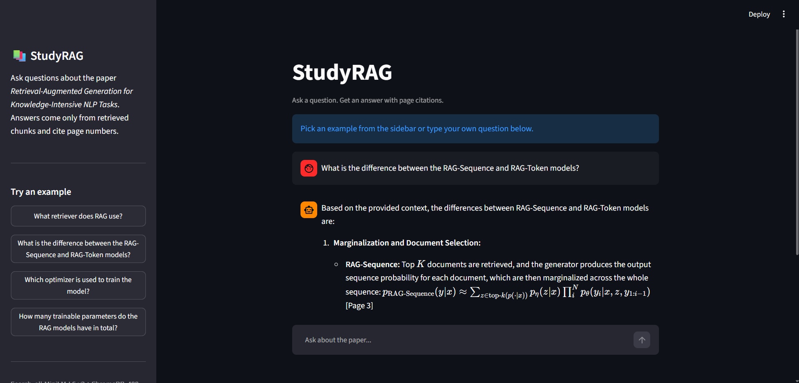

# StudyRAG

A RAG (retrieval-augmented generation) study assistant. It answers questions from a PDF and cites the page numbers it used. I built it to learn how retrieval systems work and, more importantly, how to measure whether they work.



## What it does
- Reads a PDF, splits it into chunks, and stores embeddings in ChromaDB
- Finds the most relevant chunks for a question and sends them to Gemini
- Answers using only those chunks, with page citations
- Streamlit chat UI with example questions and a view of the retrieved chunks

## How it works
1. **Load:** extract text from each page with pypdf, keeping page numbers
2. **Chunk:** split into 400-character pieces with 75 characters of overlap
3. **Embed:** all-MiniLM-L6-v2 (sentence-transformers), running locally
4. **Store:** ChromaDB
5. **Retrieve:** top 5 chunks closest in meaning to the question
6. **Answer:** Gemini is told to use only the retrieved context and cite pages

## Evaluation
I wrote a 15-question eval set on the demo paper (*Retrieval-Augmented Generation for Knowledge-Intensive NLP Tasks*). Each question has the page and a keyword that must appear in the right chunk. The metric is hit rate: is the right chunk in the top k?

| Change | Chunk size / overlap | k | Hit rate |
|--------|----------------------|---|----------|
| Baseline | 800 / 150 | 5 | 67% (10/15) |
| Retrieve more chunks | 800 / 150 | 10 | 93% (14/15) |
| Smaller chunks | 400 / 75 | 5 | 93% (14/15) |
| Larger chunks | 1200 / 200 | 5 | 60% (9/15) |

Smaller chunks matched the hit rate of retrieving twice as many large chunks, while sending the LLM about 4x less text. All the experiments are in `results.md`.

**Limitations**
- Only 15 questions, so these numbers are a strong hint, not proof
- Hit rate shows the right chunk was retrieved, not that the final answer is correct
- Questions that use different wording from the paper (for example "formulations" instead of "models") can still miss
- Numbers inside tables are hard for the embedding model to match

## Tech stack
Python, pypdf, sentence-transformers, ChromaDB, Gemini API, Streamlit

## Run it locally
```bash
git clone https://github.com/Stellarlaunch/StudyRAG.git
cd StudyRAG
python -m venv venv
venv\Scripts\activate
pip install pypdf chromadb sentence-transformers google-genai python-dotenv streamlit
```
1. Put a PDF at `data/rag_paper.pdf`
2. Create a `.env` file containing `GEMINI_API_KEY=your_key`
3. Build the database: `python src/embed_store.py`
4. Start the app: `streamlit run src/app.py`
5. Optional, run the eval: `python src/eval_retrieval.py`

## What's next
- Grow the eval set and add an answer-correctness check
- Reranking
- A quiz generator with a verifier agent (LangGraph)
- Support for multiple PDFs and a live deployment

Built by Dhiraj Musale